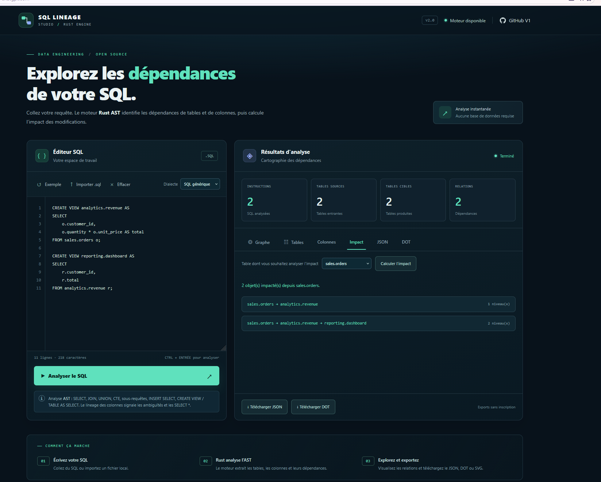
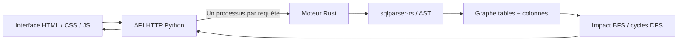

# SQL Lineage Studio

[](https://github.com/JamesGuisgand/sql-lineage-studio/actions/workflows/ci.yml)

[](engine/)

[](LICENSE)

**Analyse statique des dépendances SQL en Rust : tables, colonnes et impact transitif, avec démonstration web.**

🌐 **[Démonstration en ligne](https://rust-sql-projet.guisgand-james.fr)** · [Architecture](docs/architecture.md) · [Limites](docs/limits.md) · [Déploiement VPS](docs/DEPLOIEMENT.md) · [Publier sur GitHub](docs/GITHUB.md)



## Pourquoi ce projet ?

Comprendre les conséquences d'une modification de table ou de colonne est essentiel en Data Engineering. SQL Lineage Studio extrait les dépendances **sans connexion à une base de données** et sans exécuter le SQL. L'analyse du SQL est réalisée par un moteur Rust fondé sur un **arbre syntaxique abstrait (AST)**.

## Fonctionnalités

- **Dépendances entre tables** : `SELECT`, `JOIN`, `WITH` / CTE, sous-requêtes, `UNION`, `CREATE VIEW`, `CREATE TABLE AS SELECT`, `INSERT ... SELECT`; gestion limitée des tables de `UPDATE` et `DELETE`.
- **Dépendances entre colonnes** : alias, projections, expressions et propagation entre vues au sein du lot SQL analysé.
- **Analyse d'impact** : descendants directs/transitifs, chemins, profondeur, détection de cycles.
- **Quatre dialectes** : SQL générique, PostgreSQL, MySQL, SQLite.
- **Interface web** : éditeur SQL, graphiques, vues colonnes / impact, import `.sql`, exports JSON / DOT / SVG.
- **Exploitation** : Docker Compose, Traefik HTTPS, limites de ressources, compte non privilégié, tests automatisés.

> **Limites** : ce moteur effectue de l'analyse **statique**, pas l'évaluation de requêtes SQL. Sans schéma, `SELECT *` et certaines colonnes ambiguës ne peuvent pas être résolus entièrement. L'analyse d'impact ne concerne que les instructions fournies. Voir [les limites exactes](docs/limits.md).

## Architecture



**Stack :** Rust 2021, `sqlparser-rs` 0.46, `serde`, Python 3.13, JavaScript natif, Docker, Traefik, Linux.

## Démarrage rapide

Tester en local ou sur VPS, **sans activer Traefik** :

```bash
bash validate-v2.sh
```

L'interface de test écoute uniquement sur `127.0.0.1:18080` sur l'hôte. Pour le VPS, ouvre un tunnel SSH :

```bash
ssh -L 18080:127.0.0.1:18080 james@85.31.236.241
```

Puis navigue vers `http://127.0.0.1:18080`.

## Exemple SQL

```sql
CREATE VIEW analytics.revenue AS
SELECT o.customer_id, o.quantity * o.unit_price AS total
FROM sales.orders o;

CREATE VIEW reporting.dashboard AS
SELECT r.customer_id, r.total
FROM analytics.revenue r;
```

Le moteur identifie `sales.orders → analytics.revenue → reporting.dashboard`, puis les origines des colonnes `quantity` et `unit_price` qui contribuent à `total`.

## Utilisation CLI (sans interface)

```bash
cd engine
cargo test
cargo run -- --format json --dialect postgres --impact sales.orders examples/demo.sql
cargo run -- --format dot examples/demo.sql
```

L'API reçoit le SQL sur `POST /api/analyze` :

```bash
curl -sS -X POST http://127.0.0.1:18080/api/analyze \
  -H 'Content-Type: application/json' \
  --data '{"sql":"CREATE VIEW v AS SELECT t.id FROM raw.orders t", "dialect":"generic", "impact_table":"raw.orders"}'
```

## Qualité et CI/CD

Le workflow [`.github/workflows/ci.yml`](.github/workflows/ci.yml) se lance automatiquement sur chaque **push** et **pull request**. Il exécute :

1. `cargo fmt --check`, tests unitaires Rust, Clippy, compilation optimisée.
2. Tests HTTP Python, tests avec le véritable binaire Rust, et validation JavaScript.
3. Construction Docker complète (qui relance les tests Rust dans le Dockerfile).

Préparer le code **avant le premier push** (formate également le Rust) :

```bash
bash scripts/prepare-github.sh
```

> La CI vérifie le code, mais **ne déploie pas automatiquement sur le VPS**. La production reste volontairement indépendante des commits GitHub.

## Déploiement et retour arrière

Voir [le guide de mise en production de la V2](docs/DEPLOIEMENT.md). La procédure sauvegarde les sources et l'image V1, construit la V2 avant remplacement, vérifie `/api/info`, et permet un retour arrière sans redémarrer Traefik.

## Organisation du dépôt

```text
engine/                 Bibliothèque et CLI Rust
server.py               API Python
web/                    Interface web HTML/CSS/JS
tests/                  Tests API et tests du binaire réel
scripts/                Préparation GitHub, release, rollback, benchmark
.github/workflows/ci.yml GitHub Actions
compose.yaml            Déploiement Traefik
compose.test.yaml       Validation isolée
Dockerfile              Multi-stage Rust + runtime Python
docs/                   Architecture, limites, démonstration, procédures
```

## Historique

- **V1** : extraction des relations de tables, sorties JSON / DOT et visualisation web.
- **V2** : analyse AST, lineage des colonnes, impact multi-niveaux, plusieurs dialectes, tests et durcissement Docker.

**Auteur :** James Guisgand · [Portfolio](https://guisgand-james.fr)  
**Licence :** MIT · voir [LICENSE](LICENSE).
