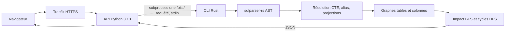

# Architecture technique V2

Le moteur de calcul est dans `engine/src/lib.rs`, l'interface CLI dans `engine/src/main.rs`, l'API dans `server.py`, l'interface dans `web/*`. Rust n'exécute aucune requête SQL. Le process Rust retourne directement JSON et DOT dans un même résultat pour supprimer le double appel V1.

Le projet est isolé par conteneur Python non-root, système de fichiers en lecture seule, tmpfs, limites CPU/mémoire, entêtes HTTP restrictifs, `Content-Length` borné, limite de temps par sous-processus et sémaphore de concurrence.

L'impact est calculé en Rust sur les liens source → cible. BFS produit un chemin minimal en nombre d'arêtes pour chaque dépendance descendante ; DFS identifie des cycles simples rencontrés (non exhaustif pour tous les cycles possibles). La charge est bornée par 500 instructions dans le moteur Rust.
